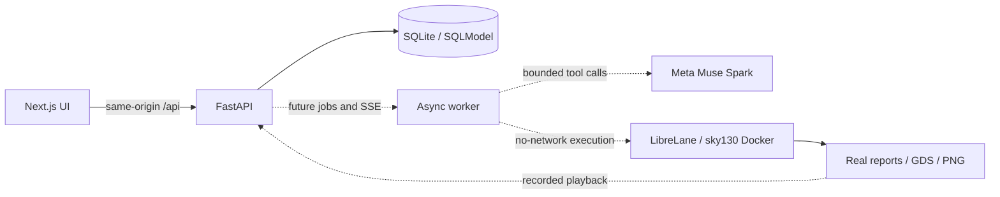

# Architecture

M0 implements the UI shell, API health, presets, and SQLite initialization. Dashed connections are later milestones and are not active. M1 adds independently verifiable golden EDA checks before any model-generated RTL execution.

API keys remain in the backend environment. The browser talks to the API through a Next.js rewrite. EDA process results are durable files, never inferred from model claims.
