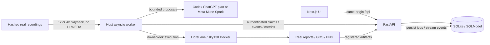

# Architecture

M0 implements the UI shell, API health, presets, and SQLite initialization. M1 adds independently verifiable golden EDA checks before any model-generated RTL execution.

M2 adds fixture-backed metrics and Iteration/Metric tables. M3 adds the shared model interface, FakeLLM, Meta SDK adapter, and a host-side Codex adapter using the user's existing ChatGPT-plan login. Health reports cached real checks; it does not invoke a model. M4 constrains tools and verifies immutable input snapshots. M5 adds the stage-based orchestrator, host worker, durable SQLite job queue, SSE events, cancellation, and selected-flow packaging. Codex credentials stay on the host; the API and EDA images never receive them.

SQLite uses WAL, short transactions, and atomic job claims inside the API container only. One active build is allowed globally for this local demo. The host worker communicates with authenticated private API routes; it never opens the database across the Docker Desktop filesystem boundary. It runs outside Compose so OAuth and Docker control never enter an application container. `make dev` starts the containerized web/API, then the host worker; `make down` stops both. Source/test snapshots and raw reports live under each run's work directory; downloads resolve registered paths inside that run. Flow iteration order is reserved before execution, so parallel completion cannot reorder chart points.

API keys remain in the backend environment. The browser talks to the API through a Next.js rewrite. EDA process results are durable files, never inferred from model claims.

M7 adds named SSE events, local Monaco diffs, real simulator case results, Recharts metrics, and GDS zoom/pan. Next.js compression is disabled to prevent buffered live events. M8 compares real configuration-only variants in parallel and ranks timing at the requested clock, then area, then flow-reported power. M9 presents the selected flow and its validated bundle; the live viewer may show a later comparison instead.

M10 materializes atomic per-run JSON/JSONL projections from the API-owned database. Authentic committed recording packs include SHA256 manifests and provenance; replay validates them before queueing, bypasses model/EDA initialization, and uses the same persisted events/artifact APIs. Cancellation applies to playback too. A separate explicitly supplied faulty UART starter exercises real independent tests and model repair; its provenance is visible and it is never described as a model-generated first attempt.
